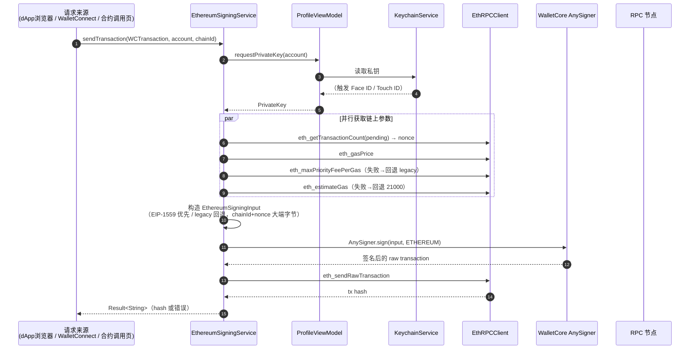
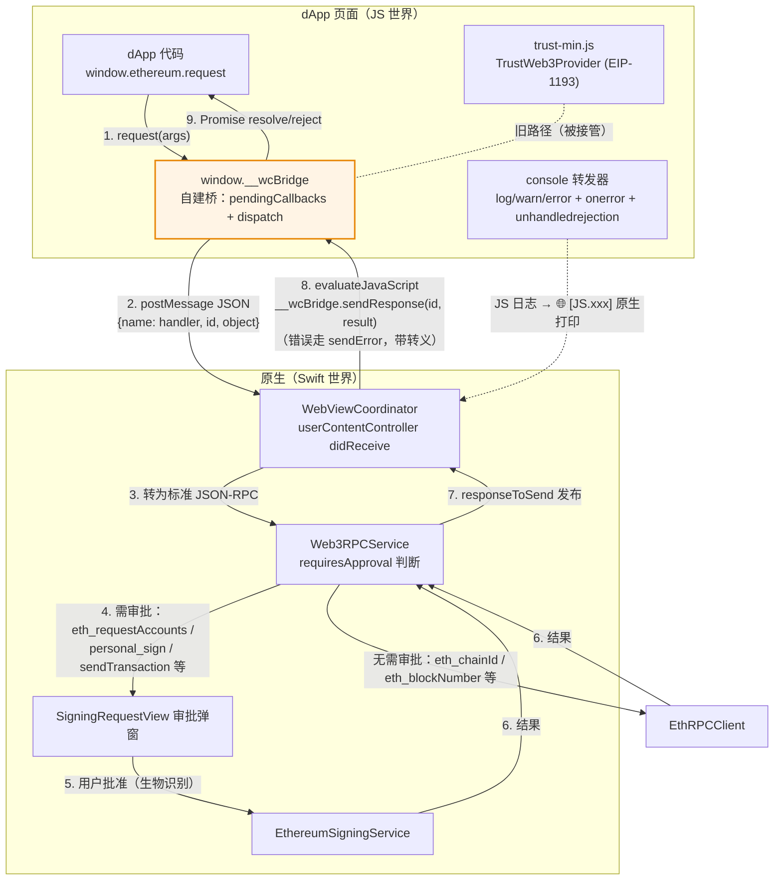
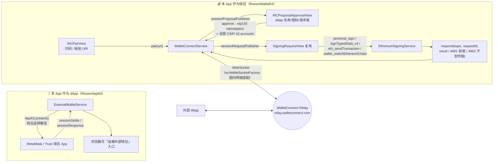
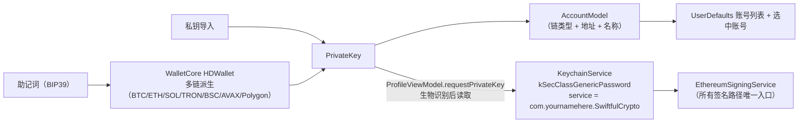

# SwiftfulCrypto — 原生 iOS 加密钱包

基于 **SwiftUI** 的原生 iOS 加密货币钱包 App。在原行情浏览应用（SwiftfulCrypto 教程项目）的基础上，扩展出一套完整的**自托管钱包 + DApp 浏览器 + WalletConnect 双向通信 + 合约调用**能力。

- **签名引擎**：Trust Wallet Core（`AnySigner`，与 Trust Wallet 同源）
- **私钥安全**：iOS Keychain + 生物识别（Face ID / Touch ID）读取
- **协议互通**：EIP-1193 注入式浏览器、WalletConnect v2（Reown）、任意合约 ABI 编解码（web3swift）

---

## 目录

- [功能特性](#功能特性)
- [技术栈与依赖](#技术栈与依赖)
- [总体架构图](#总体架构图)
- [目录结构](#目录结构)
- [关键链路详解](#关键链路详解)
  - [交易签名与广播](#1-交易签名与广播)
  - [DApp 浏览器 Web3 桥](#2-dapp-浏览器-web3-桥)
  - [WalletConnect 双向通信](#3-walletconnect-双向通信)
  - [合约调用（web3swift）](#4-合约调用web3swift)
  - [账号与私钥管理](#5-账号与私钥管理)
- [支持的链与 RPC 端点](#支持的链与-rpc-端点)
- [构建与运行](#构建与运行)
- [关键实现细节](#关键实现细节)

---

## 功能特性

| 模块 | 功能 | 说明 |
|---|---|---|
| 行情 | 首页行情 / 组合价值 / 币种详情图表 | CoinGecko API + CoreData 持久化 |
| 账号 | 助记词创建 / 私钥导入 / 导出 / 多账号切换 | 7 条链，Keychain 存储，生物识别读钥 |
| 转账 | 转账交易构造与广播、交易记录列表 | 与 dApp 端共享同一签名服务 |
| DApp 浏览器 | 内置 WKWebView 浏览器，注入 EIP-1193 Provider | dApp 可请求账号、签名、发交易 |
| WalletConnect（钱包端） | 扫码/粘贴 URI 被 dApp 连接，审批会话与请求 | personal_sign / signTypedData_v4 / eth_sendTransaction / 切链 |
| WalletConnect（dApp 端） | 连接 MetaMask / Trust 等外部钱包 | Reown AppKit 钱包选择模态 |
| 合约调用 | 任意函数签名 / ABI JSON 编码、eth_call 查询、revert 原因解析 | web3swift 编解码 + 自有签名广播链路 |
| 安全 | 生物识别签名确认、dApp 请求审批弹窗 | 所有读钥/签名路径强制生物识别 |

---

## 技术栈与依赖

| 依赖 | 版本 | 用途 |
|---|---|---|
| SwiftUI + Combine | 系统 | UI 与响应式状态 |
| [trustwallet/wallet-core](https://github.com/trustwallet/wallet-core) | 4.7.0（exact） | 助记词/派生/签名（AnySigner）、keccak256 |
| [reown-com/reown-swift](https://github.com/reown-com/reown-swift) | 2.4.0+（upToNextMajor） | WalletConnect v2：`ReownWalletKit`（钱包端）+ `ReownAppKit`（dApp 端） |
| [web3swift-team/web3swift](https://github.com/web3swift-team/web3swift) | 3.3.2（exact） | 合约 ABI 编码/解码（`EthereumContract`）、返回值/revert 解析 |
| BigInt / CryptoSwift / secp256k1.swift | web3swift 传递依赖 | 大数运算 / AES / 曲线签名 |
| CoreData | 系统 | 组合持仓持久化 |

- 最低部署目标：**iOS 14.4**
- Bundle ID：`com.yournamehere.SwiftfulCrypto`，深链 scheme：`swiftfulcrypto`

---

## 总体架构图

```mermaid
flowchart TB
    %% ============ UI 层 ============
    subgraph UI["🖥️ UI 层（SwiftUI）"]
        MT[MainTabView<br/>全局 sheet 挂载点]
        subgraph HomeTab["行情 Tab"]
            HV[HomeView / PortfolioView]
            DV[DetailView / ChartView]
        end
        subgraph BrowserTab["浏览器 Tab"]
            BTV[BrowserTabView / BrowserToolbarView]
            DABV[DAppBrowserView WKWebView]
            SRV[SigningRequestView<br/>签名审批弹窗]
        end
        subgraph ProfileTab["我的 Tab"]
            PV[ProfileView]
            ASV[AccountSelectorView / AddAccountView]
            CAV[CreateAccountByMnemonicView<br/>ImportAccountByPrivateKeyView]
            EAV[ExportAccountView]
            TRV[TransactionListView / CreateTransactionView]
            CCV[ContractCallView<br/>合约调用]
            WCPV[WCPairView 扫码/粘贴URI]
            WCCV[WCConnectionsView 会话列表]
            WPAV[WCProposalApprovalView 会话审批]
        end
    end

    %% ============ ViewModel 层 ============
    subgraph VM["🧠 ViewModel / Service 层"]
        HVM[HomeViewModel / DetailViewModel]
        BVM[BrowserViewModel]
        PVM[ProfileViewModel<br/>账号 CRUD + requestPrivateKey]
        TLVM[TransactionListViewModel<br/>本地交易记录 CoreData]
        WCS[WalletConnectService<br/>钱包端 会话/请求/响应]
        EWS[ExternalWalletService<br/>dApp 端 连外部钱包]
    end

    %% ============ 浏览器引擎 ============
    subgraph BRIDGE["🌐 DApp 浏览器引擎"]
        WVC[WebViewCoordinator<br/>WKNavigationDelegate +<br/>WKScriptMessageHandler "ethereum"]
        W3S[Web3RPCService<br/>RPC 方法分发 / 审批判断]
        TSI[TrustScriptInjection<br/>trust-min.js 注入 documentStart]
    end

    %% ============ 共享 Web3 层 ============
    subgraph WEB3["⚡ 共享 Web3 签名层 Core/Web3（浏览器 / WalletConnect / 合约调用 三端共用）"]
        ESS[EthereumSigningService<br/>personalSign / signTypedData<br/>sendTransaction]
        RPC[EthRPCClient<br/>JSON-RPC POST 客户端]
        WCT[WCTransaction<br/>交易参数模型]
    end

    %% ============ 基础服务 ============
    subgraph BASE["🧱 基础服务"]
        KC[KeychainService<br/>私钥存取]
        PORT[PortfolioDataService CoreData]
        NET[NetworkingManager]
        UTIL[LocalFileManager / HapticManager]
    end

    %% ============ 第三方 SDK ============
    subgraph SDK["📦 第三方 SDK"]
        WC_SDK[Trust Wallet Core<br/>AnySigner / HDWallet / PrivateKey]
        REOWN_W[ReownWalletKit]
        REOWN_A[ReownAppKit]
        W3[web3swift EthereumContract<br/>ABI 编码 / 解码]
    end

    %% ============ 外部 ============
    subgraph EXT["☁️ 外部服务"]
        CG[CoinGecko API]
        RPCNODE[公共 RPC 节点<br/>publicnode.com / api.avax.network]
        RELAY[WalletConnect Relay<br/>relay.walletconnect.com]
        DAPP[外部 dApp<br/>metamask.github.io 等]
        MMW[外部钱包 App<br/>MetaMask / Trust]
        CHAIN[区块链网络<br/>ETH / BSC / Polygon / Avalanche]
    end

    %% UI → ViewModel
    MT --> HomeTab & BrowserTab & ProfileTab
    BTV --> BVM
    PV --> PVM
    CCV --> PVM
    WCCV & WCPV & WPAV --> WCS
    BTV --> EWS

    %% ViewModel → 引擎 / 共享层
    BVM --> WVC
    DABV --> TSI
    DABV --> WVC
    WVC --> W3S
    W3S --> ESS & RPC
    CCV --> W3 & ESS & RPC
    WCS --> REOWN_W
    EWS --> REOWN_A
    WCS --> ESS & RPC
    ESS --> WC_SDK
    ESS --> RPC
    ESS --> WCT
    RPC --> WCT
    PVM --> KC
    PVM --> WC_SDK
    PVM -. 账号删除时清理会话 .-> WCS
    TLVM --> PORT
    HVM --> NET & PORT
    TRV --> TLVM

    %% SDK → 外部
    REOWN_W <--> RELAY
    REOWN_A <--> MMW
    W3S & RPC & CCV --> RPCNODE
    NET --> CG
    DAPP -. 页面 .-> DABV
    ESS & RPC --> CHAIN

    style WEB3 fill:#e8f4fd,stroke:#1a73e8,stroke-width:2px
    style BRIDGE fill:#fff4e5,stroke:#e8890c
    style SDK fill:#f3e8fd,stroke:#8e24aa
```

---

## 目录结构

```
SwiftfulCrypto/
├── SwiftfulCryptoApp.swift              # App 入口（EnvironmentObject 注入）
├── trust-min.js                         # Trust Wallet 注入式 Provider（EIP-1193）
│
├── Core/
│   ├── MainTabView/                     # 三 Tab 宿主：行情 / 浏览器 / 我的
│   │
│   ├── Home/                            # ── 行情 ──
│   │   ├── ViewModels/HomeViewModel.swift
│   │   └── Views/                       # HomeView / PortfolioView / CoinRowView / HomeStatsView
│   ├── Detail/                          # 币种详情 + 图表
│   ├── Components/                      # 通用小组件（搜索框 / 统计卡 / 圆形按钮…）
│   │
│   ├── Browser/                         # ── DApp 浏览器 ──
│   │   ├── Coordinators/WebViewCoordinator.swift    # 核心：JS↔原生 桥（消息收发 / 脚本注入 / 回调兑现）
│   │   ├── Services/Web3RPCService.swift            # RPC 方法分发、审批判断、转发签名层
│   │   ├── Services/TrustScriptInjection.swift      # trust-min.js 加载与注入
│   │   ├── Models/PendingRequest.swift              # 审批请求模型（浏览器/WC 共用）
│   │   └── Views/                                   # BrowserTabView / SigningRequestView / …
│   │
│   ├── Web3/                            # ── 共享 Web3 签名层（三端共用）──
│   │   ├── Services/EthereumSigningService.swift    # 签名+广播：读钥→取参→构造→AnySigner→广播
│   │   ├── Services/EthRPCClient.swift              # JSON-RPC POST 客户端（nonce/gas/estimates/广播）
│   │   ├── Models/WCTransaction.swift               # 交易参数模型（to/value/data/gas…）
│   │   └── Models/ChainType+Web3.swift              # 链类型 → WalletCore CoinType / eip155 chainId
│   │
│   ├── WalletConnect/                   # ── WalletConnect 双向 ──
│   │   ├── WalletConnectConfig.swift                # Project ID / 元数据 / 深链 scheme / 支持链
│   │   ├── Services/WalletConnectService.swift      # 钱包端：配对/审批/请求处理/响应/恢复
│   │   ├── Services/ExternalWalletService.swift     # dApp 端：AppKit 连外部钱包
│   │   ├── Services/WCDefaultCryptoProvider.swift   # WC 加密 Provider（Keychain 后端）
│   │   ├── Services/WCWalletSocketFactory.swift     # Relay 连接工厂（国内网络适配）
│   │   ├── Models/WCUIState.swift                   # 配对流程状态机
│   │   └── Views/                                   # WCPairView / 审批 / 会话列表 / QRScanner
│   │
│   ├── Profile/                         # ── 我的 / 账号 ──
│   │   ├── Models/AccountModel.swift / ChainType.swift
│   │   ├── ViewModels/ProfileViewModel.swift        # 账号 CRUD、requestPrivateKey（生物识别）
│   │   └── Views/
│   │       ├── CreateAccountByMnemonicView.swift    # 助记词创建账号
│   │       ├── ImportAccountByPrivateKeyView.swift  # 私钥导入账号
│   │       ├── ExportAccountView.swift              # 导出
│   │       ├── AccountSelectorView.swift            # 多账号切换
│   │       └── ContractCallView.swift               # 合约调用（web3swift 编解码）
│   │
│   ├── Transfer/                        # 转账 + 本地交易记录（CoreData）
│   ├── Launch/                          # 启动动画
│   ├── Settings/                        # 设置
│   └── Components/                      # 通用组件
│
├── Services/                            # 行情数据（CoinGecko）/ KeychainService / 组合持久化
├── Models/                              # 行情模型（CoinModel 等）
├── Extensions/                          # Color / String / Double 扩展
└── Utilities/                           # NetworkingManager / LocalFileManager / HapticManager
```

---

## 关键链路详解

### 1. 交易签名与广播

浏览器 dApp、WalletConnect 请求、合约调用页**三端共用** `EthereumSigningService`，保证签名逻辑唯一。



### 2. DApp 浏览器 Web3 桥

`trust-min.js`（Trust Wallet 注入式 Provider）+ 三层加固的桥接接管：



**桥接三层加固**（解决 test-dapp 等页面自带 SDK 干扰 Provider 的问题）：

1. **强制覆写 `trustwallet.postMessage`**：`(...args)` 透传，兼容 trust-min 的 `(name, id, object)` 三参调用；
2. **完全接管 `request` / `_request`**：自包含 dispatch 实现，不再调用 trust-min 内部逻辑（页面加载后其 `_request` 可能被页面脚本破坏）；
3. **回调状态迁移 + 锁定**：pending 回调挂到独立全局对象 `window.__wcBridge`，并用 `Object.defineProperty` 将 `window.ethereum` 锁为不可写/不可配置，防止页面 SDK（如 CoinbaseWalletSDK）替换后回调丢失。

### 3. WalletConnect 双向通信



要点：

- **会话持久化**：SDK 自持久化，重启后 `getSessions()` 恢复会话列表；
- **切链**：`wallet_switchEthereumChain` 请求中 `chainId` 为 hex（如 `0x38`），在支持列表内直接响应成功，否则返回 4902；随后广播 `chainChanged` 事件；
- **账号删除联动**：`ProfileViewModel.deleteAccount` 会遍历会话主动断开，删除账号即撤销 dApp 授权；
- **审批弹窗复用**：`PendingRequest` 增加 `dAppName` / `dAppIconURL` 字段，浏览器端与 WC 端共用 `SigningRequestView`。

### 4. 合约调用（web3swift）

`ContractCallView` 支持任意函数的编码、链上只读查询与真实发送：

```mermaid
flowchart TB
    IN["用户输入<br/>① 函数签名：transfer&#40;address,uint256&#41; returns &#40;bool&#41;<br/>② 或完整 ABI JSON（自动列出全部函数）<br/>③ 参数输入框（按类型自动生成）"]
    PARSE["解析器<br/>parseSignature / parseAbiJSONFunctions<br/>（支持参数名、memory/calldata、重载区分）"]
    ENC["web3swift 编码<br/>签名 → 合成最小 ABI JSON<br/>→ EthereumContract.method&#40;signature, parameters&#41;<br/>→ 4字节 selector + ABI 编码参数"]
    CONV["参数转换 convertParamValue<br/>uint/int（十进制/0x hex）· address · bool<br/>· string · bytes* · type[] 数组"]
    QUERY["「查询」eth_call"]
    SEND["「发送交易」"]
    DEC["web3swift 解码 decodeReturnData<br/>普通返回值：按 outputs 类型解码<br/>0x08c379a0 → revert(string) 原因<br/>0x4e487b71 → panic 错误码<br/>未知 selector → 自定义错误解码"]
    ESS3[EthereumSigningService<br/>签名 + 广播（同上图链路）]
    RES["UI 展示<br/>查询：返回值0 = ...<br/>发送：tx hash + 区块浏览器链接"]

    IN --> PARSE --> CONV --> ENC
    ENC --> QUERY --> DEC --> RES
    ENC --> SEND --> ESS3 --> RES

    style ENC fill:#e8f4fd,stroke:#1a73e8,stroke-width:2px
    style DEC fill:#e8f4fd,stroke:#1a73e8,stroke-width:2px
```



- **ERC20 预设模式**：转账金额用纯字符串大数运算（`decimalToWeiHex`，逐位乘10加）转 wei，**无浮点精度损失**；
- **revert 可读化**：`Web3Error.revert` 的 `reason` 直接展示给用户。

### 5. 账号与私钥管理



- 所有读钥路径**强制生物识别**（`ProfileViewModel.requestPrivateKey`），浏览器、WalletConnect、合约调用三个入口无例外；
- 导出账号同样走生物识别确认。

---

## 支持的链与 RPC 端点

端点集中在 [EthRPCClient.swift](SwiftfulCrypto/Core/Web3/Services/EthRPCClient.swift)（单一来源，浏览器 / WC / 合约调用共用）：

| Chain ID | 链 | 端点 |
|---|---|---|
| 1 | Ethereum | `https://ethereum-rpc.publicnode.com` |
| 56 | BSC | `https://bsc-rpc.publicnode.com` |
| 137 | Polygon | `https://polygon-bor-rpc.publicnode.com` |
| 43114 | Avalanche C-Chain | `https://api.avax.network/ext/bc/C/rpc` |

> ⚠️ 端点选型经过国内网络实测（2026-10）：Infura / bsc-dataseed / llamarpc 不可达，以上四个端点均验证可用。Bitcoin / Solana / Tron 支持派生与地址管理，EVM 操作覆盖上述四链。

---

## 构建与运行

### 环境要求

- Xcode 15+（本机 iOS 26 SDK，iPhone 17 Pro 模拟器）
- iOS 14.4+ 真机/模拟器（Face ID、摄像头需真机验证）

### 构建

```bash
xcodebuild -project SwiftfulCrypto.xcodeproj \
  -scheme SwiftfulCrypto \
  -destination 'platform=iOS Simulator,name=iPhone 17 Pro' \
  -derivedDataPath /Users/liwei/Library/Developer/Xcode/DerivedData/SwiftfulCrypto-dybjmmeswgttuvbptlcjxywcbndq build

xcrun simctl install booted <DerivedData>/Build/Products/Debug-iphonesimulator/SwiftfulCrypto.app
xcrun simctl launch booted com.yournamehere.SwiftfulCrypto
```

### 国内网络注意事项（重要）

1. **GitHub 访问**：此环境直连 github.com 会失败，需强制 HTTP/1.1（HTTP/2 被阻断）：
   ```bash
   git config --global http.https://github.com/.version HTTP/1.1
   ```
2. **SPM 二进制产物**（reown 的 yttrium xcframework）不走终端代理，需要用 curl 手动下载到
   `~/Library/Caches/org.swift.swiftpm/artifacts/` 预热缓存（目录名为 URL 转义形式，SHA256 需与 Package.swift 声明一致）；
3. **WalletConnect Relay**：国内直连可能不稳，真机无响应先排查网络与代理；
4. **RPC 端点**：见上表，已选用国内可达节点。

### Project ID

WalletConnect 需要在 [cloud.reown.com](https://cloud.reown.com) 注册（免费），Project ID 已配置于
[WalletConnectConfig.swift](SwiftfulCrypto/Core/WalletConnect/WalletConnectConfig.swift)。

---

## 关键实现细节

### 浏览器桥接（WebViewCoordinator）

| 问题 | 根因 | 方案 |
|---|---|---|
| Connect 点击无反应 | dApp 自带 SDK（如 CoinbaseWalletSDK）加载后破坏 trust-min Provider 的 `_request` | 完全接管 `request`/`_request`，自包含 dispatch |
| 批准后回调丢失 | `window.ethereum` 在点击与批准之间被页面脚本替换 | 回调挂到 `window.__wcBridge` + `defineProperty` 锁定 `window.ethereum` |
| JS 错误不可见 | WKWebView 的 console 默认不可见 | console/onerror/unhandledrejection 转发到原生（`🌐 [JS.xxx]` 前缀） |
| 错误送不回 dApp | `sendError(id, 中文消息)` 未加引号是非法 JS | 错误消息做 `\` `"` `\n` 转义后作为字符串字面量注入 |

### 签名参数

- **EIP-1559 优先**：`eth_maxPriorityFeePerGas` 支持时用 1559，否则自动回退 legacy（gasPrice）；
- **gas 兜底**：`eth_estimateGas` 失败回退 21000（标准转账所需）；
- **大端编码**：chainId / nonce / gas 均按 WalletCore 要求的最小大端字节传入（0 编码为空字节）。

### 合约调用金额精度

`decimalToWeiHex` 不使用 `Double`/`Decimal`，而是**逐位 乘10+加 的纯字节大数运算**，任意精度（如 `123456789.123456789` ETH）均精确转换，超精度输入直接报错而非静默截断。

### WalletConnect 响应约束

`WalletKit.respond` 的 result 只能是 JSON 可序列化类型；拒绝统一映射错误码：**4001** 用户拒绝、**4902** 不支持的链。
